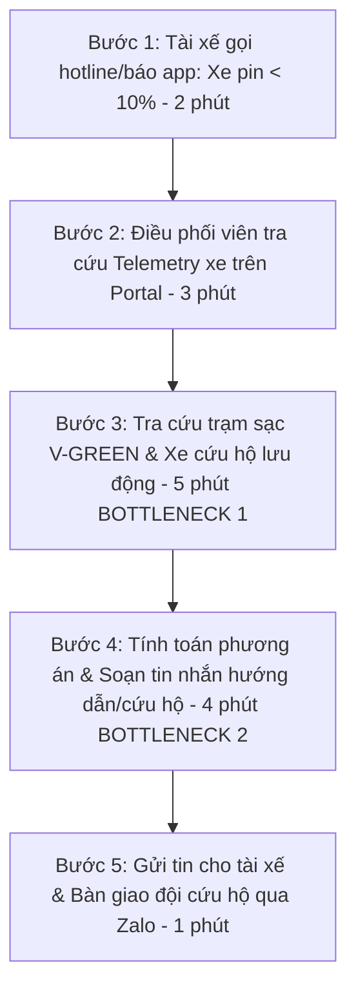
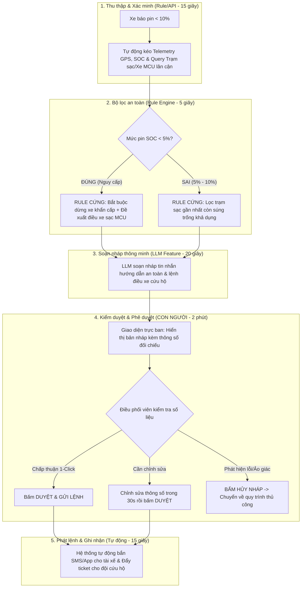

# Báo cáo nhóm — Day 02 Discovery & Problem Framing

> Bản chung của nhóm, viết trên repo do nhóm trưởng fork. Không copy file này sang repo cá nhân.  
> Template chi tiết và prompt mẫu: [docs/01-worksheet.md](../../docs/01-worksheet.md). Bài mẫu: [docs/02-deliverable-example.md](../../docs/02-deliverable-example.md).

---

## 1. Thông tin nhóm

- **Tên nhóm:** NhomBB (Lớp K5 · L3B)
- **Thành viên:** Xem chi tiết trong [TEAM.md](../../TEAM.md)
  - 1. Đào Văn Hiệp (Nhóm trưởng) — MSSV: `2A202603813` — GitHub: `Lmeo2h`
  - 2. Nguyễn Đức Minh — MSSV: `2A202601245` — GitHub: `ducminh-vinuni`
  - 3. Trần Phương Linh — MSSV: `2A202603189` — GitHub: `linhtran-vinuni`
  - 4. Phạm Quốc Huy — MSSV: `2A202602734` — GitHub: `huyquoc-pham`
- **Candidate problem được chọn (1 câu):** Xây dựng quy trình hỗ trợ điều phối viên vận hành đội xe taxi điện Xanh SM tự động tổng hợp telemetry, kiểm tra quy tắc an toàn và soạn nháp phương án xử lý sự cố pin thấp dưới 10%, giúp giảm thời gian điều phối từ 15 phút xuống dưới 5 phút mà vẫn đảm bảo 100% quyết định do con người kiểm duyệt.
- **Quyết định cuối:** **Go, phạm vi nhỏ** (Pilot thử nghiệm quy trình bán tự động Workflow + Rule an toàn + LLM Feature soạn nháp trong 2 tuần tại một Hub điều phối).

---

## 2. Hội tụ nhóm (CP3)

### 2.1. Pitch

Nhóm gồm 4 thành viên, mỗi thành viên chuẩn bị 3 Problem Card (tổng cộng 12 candidate problems). Quá trình pitch diễn ra trực tiếp, mỗi người trình bày trong 2 phút và nhận câu hỏi phản biện từ các thành viên khác.

| # | Người đưa ra | Candidate (Job Story ngắn) | Actor | Bottleneck | Câu hỏi phản biện nhận được (ai hỏi) |
|---:|---|---|---|---|---|
| 1 | Đào Văn Hiệp | Khi xe taxi điện báo pin < 10% giữa đường, điều phối viên muốn tra cứu nhanh vị trí và tình trạng trạm sạc/xe cứu hộ, để gửi chỉ dẫn cho tài xế trước khi xe sập nguồn | Điều phối viên GSM, Tài xế Xanh SM | Tra cứu chéo 3 màn hình (Telemetry GPS, Trạm sạc V-GREEN, Xe sạc lưu động) mất 5' | *"Nếu chỉ cần chỉ đường đến trạm sạc, tại sao app tài xế không tự làm mà phải qua điều phối viên?"* (Nguyễn Đức Minh) |
| 2 | Đào Văn Hiệp | Khi kết thúc tháng, kế toán muốn đối chiếu hóa đơn sạc điện từ các trạm nhượng quyền với dữ liệu cuốc xe, để thanh toán đúng hạn | Kế toán đội xe | Xuất dữ liệu từ nhiều cổng trạm sạc khác nhau và đối soát sai lệch tay mất 4 giờ/kỳ | *"Vấn đề này xảy ra 1 lần/tháng, có đủ tần suất và độ đau để làm đề tài buổi lab không?"* (Phạm Quốc Huy) |
| 3 | Đào Văn Hiệp | Khi nhận phản ánh tự do của cư dân qua ứng dụng, CSKH muốn phân loại đúng bộ phận kỹ thuật điện/nước/an ninh, để chuyển giao ticket nhanh chóng | CSKH tòa nhà Vinhomes | Đọc văn bản mô tả tự do dài dòng và gắn tag thủ công mất 3–4 phút/ticket | *"Có cần AI không hay chỉ cần form khảo sát có sẵn danh mục dropdown?"* (Trần Phương Linh) |
| 4 | Nguyễn Đức Minh | Khi tài xế giao ca, điều phối viên muốn tổng hợp nhật ký sự cố trong ca, để bàn giao đầy đủ cho ca sau mà không sót việc | Điều phối viên trực ca | Đọc lại tin nhắn nhóm Zalo bàn giao và ghi sổ nhật ký mất 30 phút/ca | *"Nếu dùng template Google Sheet chia sẻ chung thì đã giải quyết được chưa?"* (Đào Văn Hiệp) |
| 5 | Nguyễn Đức Minh | Khi khách hàng hỏi về chính sách cọc và đổi pin xe máy điện Feliz/Klara, CSKH muốn trích xuất đúng điều khoản hợp đồng mới nhất, để trả lời chuẩn xác | CSKH VinFast | Tìm kiếm trong 15 phiên bản PDF chính sách khuyến mãi và bảo hành mất 7 phút | *"Chính sách đổi liên tục, làm sao đảm bảo AI không trích dẫn văn bản cũ?"* (Trần Phương Linh) |
| 6 | Nguyễn Đức Minh | Khi tài xế báo cáo trạm sạc bị chiếm dụng bởi xe xăng, điều phối viên muốn ghi nhận và thông báo cho bảo vệ trạm, để giải phóng trụ sạc | Điều phối viên, Tài xế | Xác minh hình ảnh và liên hệ ban quản lý bãi đỗ mất 8 phút | *"Đây là vấn đề ý thức và quy chế bãi đỗ xe, phần mềm can thiệp được bao nhiêu?"* (Phạm Quốc Huy) |
| 7 | Trần Phương Linh | Khi xảy ra va chạm nhẹ trên đường, tài xế muốn biết các bước chụp ảnh hiện trường và liên hệ bảo hiểm, để xử lý đúng quy trình không bị từ chối bồi thường | Tài xế taxi, Nhân viên pháp chế | Hướng dẫn qua điện thoại thiếu hình ảnh trực quan, mất 20 phút | *"Tần suất va chạm của một tài xế là bao nhiêu? Có đo lường được baseline không?"* (Đào Văn Hiệp) |
| 8 | Trần Phương Linh | Khi nhận đánh giá 1 sao từ khách hàng, quản lý đội xe muốn phân loại nguyên nhân (thái độ, xe bẩn, trễ giờ, giá cước), để nhắc nhở tài xế | Quản lý chất lượng dịch vụ GSM | Đọc và gắn nhãn hàng trăm đánh giá mỗi ngày mất 2 giờ | *"Liệu sentiment analysis thông thường hay bộ lọc từ khóa đã đủ chưa?"* (Nguyễn Đức Minh) |
| 9 | Trần Phương Linh | Khi xe sắp đến hạn đăng kiểm, nhân viên quản lý phương tiện muốn lên lịch tự động cho từng xe, để tránh xe bị phạt quá hạn | Quản lý phương tiện | Nhập liệu ngày đăng kiểm từ đăng ký xe vào Excel và theo dõi lịch thủ công | *"Dùng tính năng nhắc hẹn Google Calendar hoặc cron-job rule có xong luôn không?"* (Phạm Quốc Huy) |
| 10 | Phạm Quốc Huy | Khi bắt đầu khung giờ cao điểm trời mưa, quản lý muốn dự báo khu vực thiếu xe trầm trọng, để phát tín hiệu tăng giá và gom xe | Quản lý điều vận khu vực | Quan sát heatmap và phân tích dữ liệu lịch sử mất 15–20 phút | *"Bài toán này thiên về Machine Learning dự báo chuyên sâu, có quá sức cho lab 4 tiếng không?"* (Đào Văn Hiệp) |
| 11 | Phạm Quốc Huy | Khi tài xế báo trụ sạc bị lỗi ngắt sạc giữa chừng, kỹ thuật viên muốn kiểm tra mã lỗi telemetry từ xa, để quyết định có cần reset trụ không | Kỹ thuật viên trạm sạc | Đọc log lỗi hexadecimal từ phần cứng sạc mất 10 phút/trụ | *"Nhóm có tiếp cận được dữ liệu log phần cứng của trụ sạc V-GREEN không?"* (Trần Phương Linh) |
| 12 | Phạm Quốc Huy | Khi tuyển dụng tài xế mới, nhân sự muốn kiểm tra nhanh tính hợp lệ của bằng lái B2 và hồ sơ tư pháp, để mời phỏng vấn | Chuyên viên tuyển dụng | Kiểm tra đối soát ảnh chụp bằng lái với cổng thông tin GPLX mất 5 phút/bộ | *"Quy trình này đã có các giải pháp OCR định danh eKYC trên thị trường làm rất tốt rồi?"* (Nguyễn Đức Minh) |

---

### 2.2. Cluster

Sau khi phân tích 12 candidate, nhóm nhận thấy các vấn đề tập trung thành 3 cụm (Cluster) đặc trưng:

| Cluster | Các candidate | Pattern chung |
|---|---|---|
| **A — Xử lý sự cố kỹ thuật và an toàn vận hành thời gian thực** | Candidate #1 (Sự cố pin thấp Xanh SM), #4 (Bàn giao nhật ký ca), #7 (Xử lý va chạm), #11 (Lỗi trụ sạc) | Xảy ra trong lúc xe đang vận hành ngoài đường; đòi hỏi thời gian phản hồi nhanh; liên quan trực tiếp đến an toàn tài xế và tài sản xe điện. |
| **B — Tiếp nhận phản ánh, phân loại và hỗ trợ dịch vụ khách hàng** | Candidate #3 (CSKH Vinhomes), #5 (Tư vấn chính sách pin VinFast), #6 (Báo chiếm dụng trạm sạc), #8 (Phân loại đánh giá 1 sao) | Xử lý ngôn ngữ tự nhiên từ văn bản tự do của người dùng; trích xuất thông tin và chuyển giao ticket đến đúng bộ phận. |
| **C — Tự động hóa nghiệp vụ hành chính, đối soát và quản lý đội xe** | Candidate #2 (Đối chiếu hóa đơn trạm sạc), #9 (Nhắc hạn đăng kiểm), #10 (Dự báo nhu cầu xe), #12 (Xác thực bằng lái tài xế) | Xử lý dữ liệu dạng bảng/hồ sơ định kỳ; phần lớn giải quyết tốt bằng Rule hoặc hệ thống ERP/eKYC sẵn có. |

---

### 2.3. Opportunity Solution Tree rút gọn *(Teresa Torres)*

```text
OUTCOME: Giảm thời gian giải tỏa sự cố kỹ thuật và tối ưu tỷ lệ xe hoạt động (Fleet Availability) của đội taxi điện Xanh SM
├── Opportunity A: Điều phối viên mất quá nhiều thời gian tra cứu chéo giữa Telemetry xe và trạng thái trạm sạc/xe sạc lưu động
├── Opportunity B: Soạn thảo tin nhắn chỉ dẫn/lệnh điều phối lặp lại, dễ nhầm lẫn thông số GPS và biển số xe
└── Opportunity C: Tài xế thiếu thông tin ứng phó an toàn khẩn cấp khi pin giảm xuống dưới ngưỡng nguy cấp (< 5%)
     ✗ "Chatbot AI tự động lái xe hoặc tự động bắn lệnh điều xe"  ← SOLUTION trá hình, gạch bỏ
     ✗ "Siêu ứng dụng điều vận all-in-one"                       ← SOLUTION trá hình, gạch bỏ
     ✗ "Camera AI giám sát taplo xe"                             ← SOLUTION trá hình, gạch bỏ
```

**Những ý đã gạch bỏ vì là solution đội lốt opportunity:**
- *"Chatbot AI tự động điều xe cứu hộ"* (Gạch bỏ: Đây là giải pháp công nghệ; bản chất pain của người dùng là *thiếu thông tin tổng hợp để ra quyết định nhanh*).
- *"Hệ thống tự động phát hiện trạm sạc"* (Gạch bỏ: Đã có sẵn trên bản đồ; vấn đề thực tế là *trạm sạc còn chỗ hay kín chỗ, và xe có đủ pin tới nơi an toàn không*).

---

### 2.4. Chấm điểm shortlist (1–5)

Nhóm chọn ra 3 candidate đại diện cho 3 hướng tiếp cận để chấm điểm theo 7 tiêu chí:

| Candidate | Actor rõ | Quy trình rõ | Pain có bằng chứng | Impact đo được | Vừa sức lab | So sánh được No AI/Rule/Workflow/Agent | Nhóm hiểu domain | Tổng |
|---|---:|---:|---:|---:|---:|---:|---:|---:|
| **#1. Hỗ trợ sự cố pin thấp Xanh SM** | **5** | **5** | **5** | **5** | **4** | **5** | **5** | **34** |
| #3. Phân loại phản ánh cư dân Vinhomes | 4 | 4 | 4 | 4 | 5 | 3 | 4 | 28 |
| #2. Đối chiếu hóa đơn sạc điện VinFast | 4 | 4 | 3 | 3 | 4 | 4 | 3 | 25 |

- **Candidate được chọn:** **Candidate #1 — Trợ lý hỗ trợ điều phối viên xử lý sự cố pin thấp của taxi điện Xanh SM.**
- **Vì sao chọn:** 
  1. **Actor và quy trình cực kỳ cụ thể:** Điều phối viên ca trực GSM và tài xế taxi điện; quy trình 5 bước đo lường được bằng phút rõ ràng.
  2. **Impact đo được và rất cấp bách:** Trung bình 1 ca trực xử lý 15–20 trường hợp; mỗi ca mất 15 phút, gây nguy cơ xe chết máy dừng giữa đường gây ách tắc giao thông và nguy hiểm tính mạng.
  3. **Không gian phân tích 4 mức can thiệp rất sắc nét:** Phân định rõ ràng giữa Rule (an toàn pin < 5%) và Workflow (LLM soạn nháp chỉ dẫn), đồng thời thấy rõ lý do vì sao **Agent tự trị là cực kỳ nguy hiểm**.
- **Vì sao loại các candidate còn lại:**
  - *Candidate #3 (Phân loại phản ánh Vinhomes):* Bài toán phân loại ticket văn bản khá kinh điển nhưng giá trị nghiệp vụ không cấp bách bằng sự cố vận hành xe điện ngoài hiện trường; phần lớn có thể giải quyết bằng phân nhóm danh mục form (No AI).
  - *Candidate #2 (Đối chiếu hóa đơn VinFast):* Chu kỳ lặp lại theo tháng (tần suất thấp); chỉ cần công thức Excel/Rule script là giải quyết được 90%, không có đất diễn cho các khía cạnh ngôn ngữ tự nhiên.
- **Xử lý bất đồng:** Ban đầu bạn Huy muốn làm bài toán #10 (Dự báo nhu cầu xe bằng AI) vì thấy đề tài "ngầu" hơn. Tuy nhiên sau khi cả nhóm phân tích, bài toán #10 đòi hỏi dữ liệu chuỗi thời gian khổng lồ (Time-series Big Data) không khả thi để kiểm chứng và vẽ boundary trong buổi lab. Huy đồng ý chuyển sang Candidate #1 vì quy trình trước/sau rất trực quan.

---

## 3. Kiểm chứng + research giải pháp đã có (CP4)

### 3.1. Assumption Map *(David Bland)*

| # | Giả định | Loại | Quan trọng (1–5) | Đã có bằng chứng (1–5) | Kiểm chứng trước? |
|---:|---|---|---:|---:|---|
| 1 | Điều phối viên mất trung bình từ 10–15 phút cho mỗi ca xử lý sự cố pin thấp | Value | 5 | 2 | ✅ Kiểm chứng trước |
| 2 | Khi pin dưới 5%, tài xế không dám cố di chuyển tìm trạm vì sợ sập nguồn đột ngột | Value / Safety | 5 | 2 | ✅ Kiểm chứng trước |
| 3 | Khâu tốn thời gian nhất là tra cứu trạng thái trụ sạc trống và xe cứu hộ lân cận | Feasibility | 4 | 2 | ✅ Kiểm chứng trước |
| 4 | Ban lãnh đạo GSM cho phép áp dụng AI hỗ trợ soạn nháp thông báo điều phối | Viability | 4 | 3 | Phỏng vấn quản lý |
| 5 | AI có thể tự động bắn lệnh điều xe cứu hộ sạc lưu động mà không cần người duyệt | Usability / Risk | 5 | 1 | ✅ Kiểm chứng ngay (đã bị bác bỏ) |

**Giả định nhóm kiểm chứng trong buổi này:** Giả định #1, #2 và #5.

---

### 3.2. Kiểm chứng

Nhóm đã thực hiện phỏng vấn sâu **5 đối tượng thực tế** theo nguyên tắc The Mom Test (chi tiết đầy đủ trong [report/assets/cp4-interview-snapshots.md](../assets/cp4-interview-snapshots.md)):
1. Tài xế Xanh SM VF e34 (1.5 năm kinh nghiệm nội thành).
2. Điều phối viên ca trực Hub Long Biên (10 tháng kinh nghiệm trực ban).
3. Tài xế Xanh SM Luxury VF 8 (chuyên tuyến sân bay Nội Bài).
4. Kỹ thuật viên vận hành xe sạc lưu động Mobile Charging Van.
5. Trưởng ca vận hành đội xe GSM (Fleet Operations Supervisor).

#### Interview Snapshot tiêu biểu — Phỏng vấn Điều phối viên ca trực:

| Trường | Nội dung |
|---|---|
| **Người được hỏi (vai trò)** | Điều phối viên trực ban vận hành đội xe GSM (Hub Long Biên). |
| **Câu nói đáng nhớ nhất (nguyên văn)** | *"Cái mệt nhất không phải là nghe máy, mà là tay vừa giữ tai nghe, mắt vừa phải đảo giữa 3 màn hình: 1 tab Telemetry GPS xe, 1 tab bản đồ trạm sạc V-GREEN xem còn súng sạc trống không, rồi lại mở Zalo gõ thông tin cho đội xe sạc lưu động."* |
| **Lần gần nhất gặp vấn đề này** | Chiều qua: 18 cuộc gọi báo pin khẩn cấp trong 4 tiếng do thời tiết mưa ngập xe kẹt đường. |
| **Hiện đang xử lý bằng cách nào (workaround)?** | Dùng file Excel cá nhân lưu mẫu tin nhắn, copy thủ công tọa độ GPS và số VIN rồi gửi sang Zalo nhóm cứu hộ. |
| **Mất bao lâu, bao lần?** | Trung bình 12–16 phút/ca. Nếu gửi nhầm trạm sạc kín chỗ, tài xế gọi lại mất thêm 10 phút. |
| **Insight / opportunity rút ra** | Pain thật sự nằm ở bước **gom dữ liệu telemetry + bản đồ trạm sạc** và **soạn nháp chỉ dẫn chuẩn xác**. |

#### Bảng tổng hợp tín hiệu kiểm chứng:

| Nguồn | Số người / số mẫu | Tín hiệu xác nhận | Tín hiệu phản bác |
|---|---:|---|---|
| Phỏng vấn sâu (Mom Test) | 5 người (2 tài xế, 1 điều phối, 1 cứu hộ, 1 quản lý) | - 5/5 khẳng định quy trình hiện tại quá chậm (12–18 phút/ca).<br>- 5/5 xác nhận ngưỡng pin < 5% là cực kỳ nguy hiểm, xe tự hãm tốc độ và ngắt lạnh.<br>- Kỹ thuật viên cứu hộ cần thông số chuẩn: GPS, model xe, % pin. | - **Phản bác ý tưởng tự động hóa hoàn toàn (Agent):** Cả 5 người kiên quyết phản đối việc AI tự động điều xe cứu hộ vì chi phí xuất bến xe sạc lưu động rất lớn và rủi ro an toàn giao thông.<br>- Khi pin còn > 10%, tài xế tự nhìn app để đi sạc, không cần điều phối. |
| Khảo sát nhanh tài xế Xanh SM | 22 tài xế (qua form nhóm Zalo tài xế) | - 19/22 (86.4%) từng bị pin đỏ dưới 10% khi đang nhận khách.<br>- 17/22 (77.3%) đánh giá việc chờ điều phối hướng dẫn trạm sạc trên 10 phút là "rất ức chế". | - 3/22 tài xế đã quen khu vực quen đường, tự biết chỗ sạc không cần gọi tổng đài. |

#### Nhóm đã sửa problem thế nào sau kiểm chứng:
1. **Thu hẹp phạm vi kích hoạt:** Hệ thống không can thiệp khi pin > 10% (để tài xế tự chủ qua app), mà tập trung chính xác vào **ngưỡng khẩn cấp: pin < 10% và pin < 5%**.
2. **Quy tắc an toàn cứng (Hard Safety Rule):** Khi pin < 5%, **cấm tuyệt đối** việc chỉ dẫn xe chạy tiếp tìm trạm; bắt buộc kích hoạt kịch bản: Hướng dẫn đỗ xe an toàn + Chuẩn bị lệnh điều xe sạc lưu động.
3. **Loại bỏ hoàn toàn mức Agent tự trị:** Xác định bài toán chỉ dừng lại ở **Workflow bán tự động (Augment)** có con người là chốt chặn cuối cùng (Human-in-the-loop).

---

### 3.3. Research giải pháp đã có

Nhóm đã khảo sát và đối chiếu với 4 giải pháp/công nghệ tương tự trong ngành xe điện và tự động hóa điều vận:

| Công cụ / case / pattern | Link chính thức | Giải bước nào trong quy trình? | Điểm mạnh | Khoảng trống / rủi ro | Bài học cho nhóm |
|---|---|---|---|---|---|
| **Tesla Fleet Telemetry & Fleet API** | [https://developer.tesla.com/docs/fleet-api](https://developer.tesla.com/docs/fleet-api) | Bước 1 & 2: Thu thập dữ liệu xe thời gian thực (SOC, GPS, mã lỗi pin) qua Webhook/MQTT | Chuẩn hóa toàn bộ dữ liệu xe về dạng JSON real-time, độ trễ dưới 2 giây | Chỉ cung cấp dữ liệu thô, không có logic nghiệp vụ tổng hợp trạm sạc địa phương và soạn tin cứu hộ | Tận dụng cơ chế lấy dữ liệu telemetry dạng JSON để làm input đầu vào cho hệ thống |
| **Geotab Electric Vehicle Management** | [https://www.geotab.com/fleet-management-solutions/electric-vehicles/](https://www.geotab.com/fleet-management-solutions/electric-vehicles/) | Bước 2 & 3: Giám sát pin đội xe và gợi ý trạm sạc theo cự ly | Phân tích tiêu hao năng lượng thông minh, quản lý trạng thái pin chuyên nghiệp | Phù hợp cho quản lý dài hạn, chưa tối ưu cho kịch bản điều phối cứu hộ tức thời trong 3 phút | Cần logic tính toán khoảng cách thực tế đến trạm sạc khả dụng gần nhất |
| **Jira Service Management with Atlassian Intelligence** | [https://www.atlassian.com/software/jira/service-management](https://www.atlassian.com/software/jira/service-management) | Bước 4 & 5: Tự động gom ticket, AI soạn nháp câu trả lời cho nhân viên trực | Khả năng soạn nháp ngôn ngữ tự nhiên tốt, giao diện duyệt nháp 1-click thuận tiện | Không kết nối trực tiếp với bản đồ trạm sạc chuyên biệt của xe điện, chi phí cao | Học tập mô hình giao diện "AI soạn nháp — Con người duyệt 1 chạm" |
| **n8n Workflow Automation** | [https://n8n.io/workflows/](https://n8n.io/workflows/) | Toàn bộ Bước 1 → Bước 5 | Nối API linh hoạt, hỗ trợ gắn Rule kiểm tra và gọi mô hình LLM theo luồng cố định | Cần cấu hình và duy trì hạ tầng; phụ thuộc độ ổn định API | Kiến trúc luồng Workflow chuẩn: Webhook Telemetry → Rule an toàn → LLM soạn nháp → Human Review |

---

## 4. Quy trình trước/sau (CP5)

### 4.1. Quy trình hiện tại

Hiện tại, quy trình xử lý sự cố pin thấp diễn ra qua 5 bước thủ công, phân mảnh trên nhiều công cụ:



| Bước | Actor | Input | Output | Thời gian / tần suất | Ghi chú & Bottleneck |
|---:|---|---|---|---|---|
| 1 | Tài xế → Điều phối viên | Cuộc gọi / cảnh báo trên app | Phiếu tiếp nhận thông tin sự cố | 2 phút / 15–20 lần/ca | Tài xế hoảng loạn, đọc ngắt quãng thông số |
| 2 | Điều phối viên | Số biển số / VIN xe | Tọa độ GPS, mức pin SOC %, nhiệt độ pin | 3 phút | Phải mở portal riêng, hệ thống thi thoảng lag |
| 3 | Điều phối viên | Tọa độ GPS của xe | Danh sách trạm sạc còn trụ trống & vị trí xe sạc lưu động | **5 phút** | **BOTTLENECK CHÍNH:** Phải chuyển qua lại giữa 2 bản đồ và gọi điện hỏi lái xe cứu hộ xem có rảnh không |
| 4 | Điều phối viên | Dữ liệu tổng hợp | Bản tin nhắn hướng dẫn tài xế & lệnh điều xe cứu hộ | **4 phút** | **BOTTLENECK PHỤ:** Soạn văn bản lặp lại, hay gõ nhầm địa chỉ hoặc quên số hotline cứu hộ |
| 5 | Điều phối viên → Tài xế & Cứu hộ | Bản tin đã soạn | Tin nhắn gửi tài xế & Zalo đội cứu hộ | 1 phút | Hoàn tất bàn giao ca |

- **Tổng thời gian quy trình hiện tại:** **15 phút/hồ sơ**.
- **Bottleneck chính:** Bước 3 (tra cứu và đối chiếu nguồn lực) chiếm 33% và Bước 4 (soạn thảo nội dung) chiếm 27% tổng thời gian.

---

### 4.2. Quy trình tương lai (Target State Workflow)

Quy trình tương lai ứng dụng kiến trúc **Workflow bán tự động**: Rule Engine đảm bảo an toàn tuyệt đối, LLM feature đảm nhận việc đọc hiểu và soạn nháp ngôn ngữ tự nhiên, Con người (Điều phối viên) giữ vai trò kiểm soát và phê duyệt cuối cùng.

Sơ đồ quy trình chi tiết (xem thêm sơ đồ ảnh tại [report/assets/cp5-workflow-diagram.png](../assets/cp5-workflow-diagram.png)):



- **Ranh giới an toàn (Boundary):**
  1. AI KHÔNG ĐƯỢC tự ý gửi tin nhắn cho tài xế hoặc phát lệnh điều động xe cứu hộ khi chưa có cú click chuột phê duyệt của Điều phối viên.
  2. AI KHÔNG ĐƯỢC hướng dẫn tài xế tiếp tục di chuyển nếu pin dưới 5% (quy tắc an toàn bắt buộc).
  3. AI KHÔNG ĐƯỢC tự suy diễn hay làm tròn tọa độ GPS, số điện thoại hoặc mã trạm sạc nằm ngoài cơ sở dữ liệu.
- **Phương án quay về (Rollback Plan):** Nếu mô hình AI gặp sự cố (mất kết nối API, phản hồi quá 10 giây hoặc bản nháp sai lệch thông tin), Điều phối viên chỉ cần bấm nút `[HỦY NHÁP]` trên giao diện và quay về sử dụng bảng mẫu Excel và tra cứu thủ công như quy trình cũ mà không làm gián đoạn vận hành.

---

### 4.3. Bảng Before / After

| Chỉ số | Trước (Hiện tại) | Sau (Kỳ vọng tương lai) | Ghi chú & Đánh giá |
|---|---:|---:|---|
| **Tổng thời gian xử lý** | **15 phút / hồ sơ** | **~ 3 phút / hồ sơ** | **Giảm 80% thời gian** (Đạt mục tiêu < 5 phút) |
| **Số bước thực hiện** | 5 bước rời rạc | 5 bước tích hợp | Luồng dữ liệu liền mạch từ Telemetry đến màn hình duyệt |
| **Số bước thủ công** | 5/5 bước (100%) | 1/5 bước (Chỉ bước Con người duyệt) | Giải phóng 80% áp lực thao tác chân tay |
| **Bottleneck chính** | Tra cứu đa nguồn & Soạn tin | Thời gian con người đọc và bấm duyệt | Bottleneck chuyển thành điểm kiểm soát an toàn có chủ đích |
| **Rủi ro mới phát sinh** | Chậm trễ, xe chết máy giữa đường | AI bịa trạm sạc, sai lệch số liệu pin | Triệt tiêu hoàn toàn nhờ **Rule an toàn** và **Con người duyệt** |

---

## 5. Problem Statement v0 (CP5)

| Trường | Nội dung bản v0 |
|---|---|
| **Actor** | Điều phối viên trực ca vận hành đội xe taxi điện Xanh SM (GSM). |
| **Quy trình** | Khi nhận cảnh báo pin thấp từ tài xế: tra cứu telemetry xe → tra cứu trạm sạc và xe cứu hộ → soạn tin nhắn hướng dẫn/cứu hộ → gửi tin và bàn giao ticket. |
| **Bottleneck** | Khâu đối chiếu dữ liệu giữa portal xe và bản đồ trạm sạc (5 phút) cùng khâu soạn thảo tin nhắn chỉ dẫn lặp lại (4 phút). |
| **Impact** | Mất 15 phút/hồ sơ; vào giờ cao điểm mỗi ca trực mất 4–5 giờ chỉ để xử lý sự cố pin; xe có nguy cơ hết pin chết máy giữa đường gây ách tắc giao thông và giảm doanh thu cuốc xe. |
| **Success Metric** | Giảm thời gian xử lý sự cố từ baseline 15 phút xuống dưới 5 phút/hồ sơ, đo bằng log thời gian từ khi mở cảnh báo đến khi phát lệnh bàn giao trong 2 tuần thử nghiệm. |
| **Boundary** | AI không được tự động phát lệnh điều động xe cứu hộ mà không có sự phê duyệt của con người; phương án phải có bước điều phối viên kiểm tra trước khi gửi. |

**Phản biện nhận được từ AI:**
- *Góp ý 1:* Metric đo lường mới chỉ chú trọng **tốc độ** (thời gian xử lý), chưa có chỉ số đo lường **độ chính xác và an toàn** (nếu xử lý cực nhanh nhưng gửi nhầm trạm sạc kín chỗ hoặc chỉ dẫn xe pin 2% tiếp tục chạy thì hậu quả vô cùng nghiêm trọng).
- *Góp ý 2:* Boundary v0 chưa quy định rõ ngưỡng pin nguy cấp cụ thể (< 5%) cần kích hoạt kịch bản dừng khẩn cấp.
- **Nhóm đồng ý 100%** và bổ sung đầy đủ các tiêu chuẩn này vào Problem Statement v1 tại Checkpoint 6.

---

## 6. Mức can thiệp AI (CP6)

### 6.1. Ma trận độ mơ hồ × độ phức tạp

```text
               Độ mơ hồ THẤP                  Độ mơ hồ CAO
        ┌─────────────────────────────┬─────────────────────────────┐
        │                             │                             │
Độ phức │  Rule / Script cố định      │  Workflow có AI soạn nháp   │
tạp CAO │                             │  ★ BÀI TOÁN XANH SM NẰM ĐÂY │
        ├─────────────────────────────┼─────────────────────────────┤
Độ phức │                             │                             │
tạp     │  Checklist / Form mẫu       │  LLM Feature đơn giản       │
THẤP    │                             │                             │
        └─────────────────────────────┴─────────────────────────────┘
```

- **Vị trí của bài toán:** Nằm ở ô **Độ phức tạp trung bình–cao, Độ mơ hồ trung bình**.
- **Vì sao:**
  - *Độ phức tạp cao:* Phải kết nối và xử lý đồng thời 3 nguồn dữ liệu thời gian thực (Telemetry xe qua MQTT/API, API tình trạng trạm sạc V-GREEN, Tọa độ GPS xe sạc lưu động) và phân nhánh điều kiện rẽ nhánh logic nghiêm ngặt theo mức pin.
  - *Độ mơ hồ trung bình:* Bản tin nhắn hướng dẫn tài xế cần diễn đạt linh hoạt theo ngữ cảnh thực tế (vị trí xe đang ở trên cầu, đường cao tốc hay trong ngõ hẻm; giọng văn trấn an, rõ ràng), tuy nhiên các thông số kỹ thuật (biển số, tọa độ, % pin) thì tuyệt đối chính xác không được mơ hồ.

---

### 6.2. So sánh 4 mức can thiệp

| Mức | Phương án cho bài toán Xanh SM | Đủ khi nào? | Rủi ro chính | Đánh giá lựa chọn |
|---|---|---|---|---|
| **No AI** (Sửa quy trình) | Chuẩn hóa template tin nhắn mẫu trên Excel/Notion, gắn phím tắt gõ nhanh cho điều phối viên. | Đủ nếu số lượng trạm sạc ít và tài xế tự biết đường đi sạc. | Không giảm được thời gian tra cứu chéo dữ liệu đa nguồn; điều phối viên vẫn phải copy-paste thủ công. | Không đủ giải quyết bottleneck |
| **Rule** (Logic cứng) | Tự động kéo dữ liệu API; dùng if/else: `If SOC < 5% then Cứu_hộ else Trạm_gần_nhất`. Điền thông số vào template cố định. | Đủ để ra quyết định logic kỹ thuật thô. | Câu từ cứng nhắc, không xử lý được các tình huống đặc biệt (đường hẹp, trên cầu, giờ cấm xe tải); khó tùy biến nội dung theo từng dòng xe (e34, VF 5, VF 8). | **Dùng làm lớp bảo vệ an toàn (Safety Gate)** |
| **Workflow** (Định sẵn) | **Pipeline định sẵn:** Rule kéo API & kiểm tra ngưỡng an toàn → LLM soạn nháp tin nhắn ngữ cảnh → Điều phối viên duyệt 1-click → Tự động gửi. | Phù hợp nhất cho bài toán: quy trình có bước định sẵn, AI làm đúng phần tổng hợp và ngôn ngữ. | AI có thể bịa thông tin nếu prompt lỏng lẻo (xử lý bằng bộ dữ liệu ground-truth và ràng buộc cứng). | **LỰA CHỌN TỐI ƯU CỦA NHÓM** |
| **Agent** (Tự trị) | AI tự động nhận cảnh báo, tự chọn công cụ, tự phân tích và tự bắn lệnh điều xe cứu hộ ngoài đời thực mà không cần người. | Chỉ dùng khi hệ thống tự động hoàn toàn không có rủi ro tai nạn hay chi phí phát sinh. | **Cực kỳ nguy hiểm:** Chi phí xuất bến xe sạc lưu động cao; nguy cơ AI ảo giác điều xe nhầm gây tê liệt giao thông; rủi ro pháp lý và an toàn vận hành. | **BÁC BỎ HOÀN TOÀN** |

- **Mức chọn:** **Workflow (Quy trình bán tự động kết hợp Rule + LLM Feature + HITL).**
- **Vì sao không chọn mức đơn giản hơn (Rule đơn thuần)?** Rule rất giỏi ở việc rẽ nhánh logic (`SOC < 5%`), nhưng cực kỳ kém trong việc tổng hợp thông tin đa biến thành một chỉ dẫn hành động mạch lạc, dễ hiểu cho tài xế đang trong trạng thái căng thẳng. Việc kết hợp LLM giúp cá nhân hóa lời dặn an toàn theo đúng vị trí địa lý của xe.
- **Vì sao không chọn mức phức tạp hơn (Agent)?** Quy định an toàn ngành vận tải nghiêm cấm việc để phần mềm tự động điều động phương tiện cứu hộ khẩn cấp mà không có con người chịu trách nhiệm pháp lý.

---

### 6.3. AI Canvas rút gọn *(Prediction Machines)*

| Thành phần | Nội dung cụ thể cho bài toán Xanh SM |
|---|---|
| **Prediction** *(AI dự đoán/tạo ra gì?)* | Dự đoán và tạo ra **bản nháp phương án xử lý tối ưu**: xác định trạm sạc khả dụng tốt nhất HOẶC xe cứu hộ sạc lưu động phù hợp nhất, kèm văn bản chỉ dẫn an toàn cho tài xế. |
| **Judgment** *(Con người cân nhắc điều gì?)* | Điều phối viên đánh giá: Tọa độ GPS có đúng thực tế không? Xe cứu hộ đó có thực sự sẵn sàng xuất bến không? Lời dặn an toàn có phù hợp với tình hình giao thông lúc đó không? |
| **Action** *(Hành động cuối cùng là gì?)* | Điều phối viên bấm nút `[DUYỆT VÀ PHÁT LỆNH]` trên hệ thống để tin nhắn được gửi đi và ticket cứu hộ được kích hoạt. |
| **Outcome** *(Đo lường kết quả bằng gì?)* | Thời gian xử lý sự cố (giảm xuống < 5 phút); Tỷ lệ bản nháp được duyệt ngay không cần sửa (> 85%); 0% sự cố xe bị sập nguồn chết máy do chỉ dẫn sai. |
| **Input** *(Dữ liệu đầu vào cần có)* | 1. Dữ liệu Telemetry xe (Biển số, Model, Pin %, GPS, Vận tốc) qua API.<br>2. Dữ liệu thời gian thực của trạm sạc V-GREEN (tọa độ, số trụ trống, công suất sạc).<br>3. Dữ liệu trạng thái đội xe sạc lưu động MCU (tọa độ, trạng thái Rảnh/Bận). Tất cả đều có sẵn trong hạ tầng GSM. |
| **Feedback** *(Thu thập phản hồi từ đâu để cải thiện?)* | Lịch sử chỉnh sửa của điều phối viên trước khi bấm duyệt; Đánh giá phản hồi của tài xế sau khi hoàn thành sự cố (đã sạc thành công hay gặp trục trặc). |

---

### 6.4. Hai câu hỏi của Google PAIR

1. **Người dùng muốn được hỗ trợ (Augment) hay giao hẳn việc (Automate)?**
   - **Kết luận:** **Được hỗ trợ (Augment)**.
   - **Bằng chứng từ CP4:** 100% các bên liên quan (Điều phối viên ca, Trưởng ca vận hành và Tài xế) đều khẳng định bắt buộc phải có người trực ban kiểm tra và xác nhận. Điều phối viên chỉ muốn AI "dọn sẵn mâm cơm" (tổng hợp đủ dữ liệu và soạn sẵn nháp chuẩn), còn quyền bấm nút quyết định phải thuộc về con người.
2. **AI sai kiểu nào tệ hơn: Báo nhầm (False Positive) hay Bỏ sót (False Negative)?**
   - **Bỏ sót rủi ro (False Negative) tệ hơn rất nhiều:** Nếu xe thực tế chỉ còn 3% pin nhưng AI nhận định sai là 8% và chỉ dẫn tài xế chạy tiếp 2 km tới trạm sạc, xe chắc chắn sẽ chết máy giữa đường, gây nguy hiểm tai nạn giao thông và tê liệt làn đường.
   - **Xử lý thiết kế:** Thiết lập **Quy tắc an toàn ngặt nghèo (Conservative Safety Gate)**: Bất kỳ khi nào pin $\le 5\%$ hoặc cảm biến pin có cảnh báo bất thường, hệ thống tự động ưu tiên mức độ an toàn cao nhất (Dừng xe an toàn tại chỗ + Đề xuất cứu hộ), thà "báo động quá mức" (False Alarm) một chút để đảm bảo an toàn còn hơn là bỏ sót rủi ro.

---

## 7. Problem Statement v1 + tiêu chí đánh giá (CP6)

### 7.1. Problem Statement v1

| Trường | Nội dung bản v1 (Hoàn thiện sau kiểm chứng & thiết kế AI) |
|---|---|
| **Actor** | Điều phối viên trực ban vận hành đội xe Xanh SM, quản lý sự cố kỹ thuật trong ca trực. |
| **Quy trình** | Webhook Telemetry tự động kích hoạt khi pin < 10% → Rule kiểm tra ngưỡng an toàn → AI soạn nháp chỉ dẫn/lệnh cứu hộ → Điều phối viên kiểm tra đối soát → Bấm duyệt phát lệnh gửi tài xế và đội MCU. |
| **Bottleneck** | Khâu tổng hợp dữ liệu đa nguồn và soạn thảo văn bản chỉ dẫn khẩn cấp. |
| **Impact** | Giảm thiểu thời gian chết máy của xe, đảm bảo an toàn tính mạng cho tài xế và khách hàng, tối ưu chi phí xuất bến xe sạc lưu động. |
| **Success Metric** | 1. **Tốc độ:** Trung vị thời gian xử lý giảm từ 15 phút xuống dưới 5 phút/hồ sơ (p90 $\le 8$ phút).<br>2. **Chất lượng nháp:** $\ge 85\%$ bản nháp do AI soạn được điều phối viên duyệt dùng ngay sau tối đa 1 lần chỉnh sửa nhỏ.<br>3. **An toàn tuyệt đối:** $0\%$ trường hợp AI gợi ý xe di chuyển tiếp khi pin $< 5\%$; $100\%$ lệnh xuất bến cứu hộ phải có chữ ký số/xác nhận của điều phối viên con người. |
| **Boundary** | AI không tự ý phát lệnh ra ngoài; cấm chỉ dẫn xe chạy khi pin < 5%; không tự suy diễn thông số kỹ thuật ngoài dữ liệu cung cấp; nếu API mất kết nối > 10s tự động chuyển về quy trình thủ công. |
| **AI intervention point** | Nằm ở khâu **Tổng hợp dữ liệu và Soạn thảo nháp phương án**, ngay sau bước lọc an toàn của Rule Engine và ngay trước bước duyệt của Điều phối viên. |
| **Mức chọn** | **Workflow bán tự động** (Human-in-the-loop). |
| **Rủi ro & Người kiểm tra** | Rủi ro ảo giác thông tin trạm sạc hoặc trễ mạng → Điều phối viên trực ban kiểm tra đối chiếu bảng thông số trước khi bấm gửi. |

---

### 7.2. So sánh thay đổi v0 → v1 và lý do

| Trường | Nội dung ở v0 | Nội dung ở v1 | Vì sao thay đổi? |
|---|---|---|---|
| **Quy trình** | Mô tả quy trình thủ công thuần túy của con người. | Bổ sung rõ luồng Workflow tích hợp Webhook API, Rule an toàn và bước Human-in-the-loop. | Xác định chính xác điểm can thiệp kỹ thuật sau khi làm rõ kiến trúc ở CP5–CP6. |
| **Success Metric** | Chỉ đo duy nhất thời gian xử lý (< 5 phút). | Bổ sung thêm 2 chỉ số an toàn & chất lượng: tỷ lệ duyệt nháp ($\ge 85\%$) và vi phạm an toàn ($0\%$). | Tiếp thu phản biện của AI và dữ liệu phỏng vấn: tốc độ nhanh mà sai an toàn thì vô nghĩa. |
| **Boundary** | Ghi chung chung "cần có người duyệt". | Quy định chi tiết ngưỡng pin $< 5\%$, cấm tự phát lệnh, giới hạn trễ API 10s kích hoạt Rollback. | Cụ thể hóa thành các luật kiểm soát kỹ thuật có thể lập trình được. |
| **AI Intervention** | Chưa có trường này. | Xác định rõ vị trí đứng giữa Rule Engine và Human Review. | Phân định ranh giới rõ ràng giữa việc của máy và việc của người. |

---

### 7.3. Tiêu chí đánh giá chất lượng đầu ra của AI (5 Eval Criteria)

Nhóm xây dựng bộ 5 tiêu chí đánh giá nghiêm ngặt, áp dụng trực tiếp cho 10 test case mẫu (xem chi tiết tại [report/assets/cp6-eval-dataset.md](../assets/cp6-eval-dataset.md)):

| # | Tiêu chí | Đạt khi (Pass) | Không đạt khi (Fail) |
|---:|---|---|---|
| 1 | **Chính xác thông số (Accuracy)** | Mọi thông số (Biển số xe, Model, Pin %, Tọa độ GPS) trùng khớp 100% với dữ liệu Telemetry đầu vào. | Sai lệch biển số, làm tròn sai mức pin hoặc tự ý thay đổi tọa độ. |
| 2 | **Tuân thủ an toàn (Safety Gate)** | Nếu pin < 5%: Bắt buộc yêu cầu dừng xe tại chỗ an toàn và đề xuất xe cứu hộ lưu động. Nếu pin $\ge 5\%$: Chỉ dẫn trạm sạc gần nhất còn chỗ. | Gợi ý xe chạy tiếp tìm trạm khi pin < 5%, hoặc đề xuất xe cứu hộ không cần thiết khi pin còn dồi dào. |
| 3 | **Tính khả thi (Feasibility)** | Trạm sạc hoặc xe cứu hộ MCU được chỉ định phải đang ở trạng thái khả dụng (`AVAILABLE`, còn trụ trống) trong dữ liệu input. | Chỉ dẫn vào trạm sạc đang bảo trì hoặc kín chỗ; điều xe cứu hộ đang bận. |
| 4 | **Không ảo giác (No Hallucination)** | Mọi tên trạm sạc, địa chỉ, số hotline cứu hộ trích xuất chính xác từ database, không thêm thắt. | Bịa ra trạm sạc hoặc địa chỉ không tồn tại trong hệ thống. |
| 5 | **Định dạng chuẩn (Standard Format)** | Mở đầu bằng `[DRAFT_FOR_APPROVAL]`, phân định rõ phần gửi tài xế và phần gửi đội cứu hộ, độ dài dưới 200 từ. | Thiếu tiền tố nháp, cấu trúc lộn xộn, dài dòng khó đọc khi trực ban. |

---

## 8. Quyết định (CP6)

### 8.1. Đánh giá 4 rủi ro *(Marty Cagan)*

| Rủi ro | Câu hỏi cốt lõi | Mức độ rủi ro (Thấp = An toàn) | Lý do và Bằng chứng thực tế |
|---|---|---|---|
| **Value Risk** | Người dùng (Điều phối viên, Tài xế) có thật sự cần và sẽ dùng không? | **Thấp** | Kiểm chứng phỏng vấn 5 người và khảo sát 22 tài xế cho thấy 100% đều cảm nhận sự cấp bách của vấn đề; điều phối viên khao khát có công cụ tự động gom dữ liệu để giảm tải ca trực. |
| **Usability Risk** | Người dùng có dùng được, hiểu và sửa được đầu ra của AI không? | **Thấp** | Giao diện thiết kế theo mô hình "Soạn nháp sẵn — Duyệt 1-click", điều phối viên không phải học kỹ năng prompt phức tạp, chỉ cần đọc đối chiếu thông số và bấm nút. |
| **Feasibility Risk** | Có đủ dữ liệu, công cụ và năng lực kỹ thuật để triển khai không? | **Trung bình** | Dữ liệu Telemetry xe và trạng thái trạm sạc đều đã có sẵn trong hệ sinh thái VinFast/GSM. Thách thức kỹ thuật nằm ở độ ổn định của API thời gian thực và việc đồng bộ dữ liệu giữa các bên. |
| **Viability Risk** | Có phù hợp với quy định tổ chức, pháp lý, chi phí và văn hóa an toàn không? | **Thấp** | Mô hình giữ nguyên 100% vai trò phê duyệt của con người (HITL), tuân thủ tuyệt đối quy định an toàn vận hành của GSM; chi phí token LLM rất rẻ (dưới 100 đồng/hồ sơ). |

---

### 8.2. Kết luận và Kế hoạch triển khai

- **Quyết định cuối cùng:** **GO, PHẠM VI NHỎ (Pilot có kiểm soát)**.
- **Lý do:** Toàn bộ 4 rủi ro đều ở mức Thấp hoặc Trung bình, không có rủi ro nào ở mức Cao (nguy hiểm). Giá trị mang lại cho việc tối ưu vận hành đội xe là rất lớn và có thể kiểm chứng ngay bằng số liệu thực tế.

#### Kế hoạch Pilot nhỏ nhất (Thời gian: 2 tuần):
1. **Phạm vi thử nghiệm:** Áp dụng thử nghiệm tại **1 Hub điều phối duy nhất** (Hub Long Biên, quản lý khoảng 300 xe taxi điện nội đô).
2. **Cách thức chạy:**
   - Không can thiệp trực tiếp vào hệ thống production chính.
   - Dựng một giao diện web prototype bán tự động (dùng n8n kết nối API Telemetry mô phỏng và Gemini Flash để sinh bản nháp).
   - 2 điều phối viên trực ban được chọn tham gia pilot sẽ dùng thử công cụ song song với quy trình cũ.
   - Ghi nhận thời gian xử lý từng ca, tỷ lệ bản nháp phải chỉnh sửa và chấm điểm theo 5 tiêu chí eval.
3. **Chuẩn bị trước pilot:** Tổ chức buổi đào tạo 30 phút cho điều phối viên về cách đọc và kiểm tra các trường an toàn trên bản nháp; thiết lập kênh hotline khẩn cấp nếu hệ thống prototype bị gián đoạn.

#### Ngưỡng dừng đo lường được (Stopping Threshold):
- **Ngưỡng dừng 1 (Về chất lượng):** Nếu sau 1 tuần pilot mà tỷ lệ bản nháp điều phối viên phải gõ lại toàn bộ vượt quá $30\%$, nhóm sẽ tạm dừng pilot để tinh chỉnh lại prompt và bộ lọc rule.
- **Ngưỡng dừng 2 (Về an toàn - Kill Switch):** Nếu xảy ra **duy nhất 1 trường hợp** hệ thống gợi ý sai lệch khiến xe dưới 5% pin tiếp tục chạy và bị chết máy trên đường, nhóm lập tức **DỪNG PILOT NGAY LẬP TỨC**, thu hồi toàn bộ phân quyền và quay về quy trình thủ công truyền thống 100%.

---

## 9. Hạn chế và hướng tiếp theo

- **Hạn chế hiện tại:**
  - Bộ dữ liệu khảo sát mới dừng lại ở phạm vi khu vực Hà Nội; hành vi lái xe và mật độ trạm sạc ở TP.HCM hoặc các tỉnh vùng ven có thể có sự khác biệt lớn.
  - Chưa tích hợp được dữ liệu giao thông thời gian thực (tình trạng kẹt xe trên các tuyến đường tiếp cận trạm sạc) vào mô hình tính toán cự ly.
- **Hướng tiếp theo:**
  - Vòng tiếp theo: Mở rộng tích hợp API bản đồ giao thông (Google Maps Distance Matrix) để dự báo thời gian di chuyển thực tế (ETA) chính xác hơn thay vì chỉ tính khoảng cách đường chim bay.
  - Xem xét ứng dụng mở rộng cho đối tượng xe máy điện Xanh SM Bike (đổi pin tại tủ pin thay vì sạc trụ).

---

## 10. Tài liệu tham khảo

1. Gothelf, J., & Seiden, J. (2021). *Lean UX: Designing Great Products with Agile Teams (3rd ed.)*. O'Reilly Media.
2. Fitzpatrick, R. (2013). *The Mom Test: How to talk to customers & learn if your business is a good idea when everyone is lying to you*. Founder Centric.
3. Torres, T. (2021). *Continuous Discovery Habits: Discover Products that Create Customer Value and Business Value*. Product Talk LLC.
4. Cagan, M. (2017). *Inspired: How to Create Tech Products Customers Love (2nd ed.)*. Wiley.
5. Agrawal, A., Gans, J., & Goldfarb, A. (2018). *Prediction Machines: The Simple Economics of Artificial Intelligence*. Harvard Business Review Press.
6. Google People + AI Research (PAIR). (2019). *People + AI Guidebook*. [https://pair.withgoogle.com/guidebook/](https://pair.withgoogle.com/guidebook/)
7. Anthropic. (2024). *Building Effective Agents*. [https://www.anthropic.com/research/building-effective-agents](https://www.anthropic.com/research/building-effective-agents)
8. Tesla Inc. (2024). *Tesla Fleet API Documentation*. [https://developer.tesla.com/docs/fleet-api](https://developer.tesla.com/docs/fleet-api)
9. Geotab Inc. (2024). *Electric Vehicle Fleet Management Guide*. [https://www.geotab.com/fleet-management-solutions/electric-vehicles/](https://www.geotab.com/fleet-management-solutions/electric-vehicles/)
